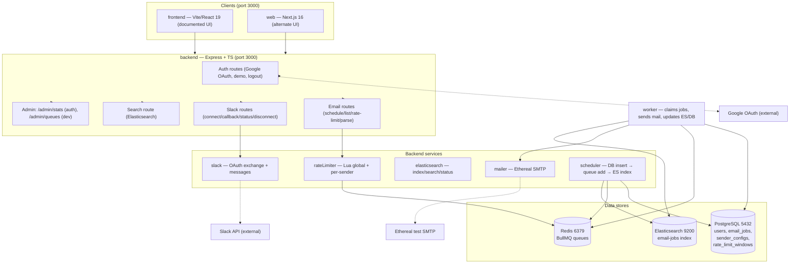
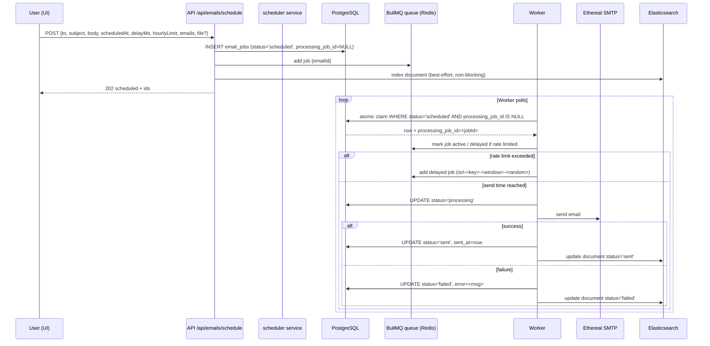

# Project Bible — ReachInbox Email Scheduler

**Source location:** `F:\Projects\SDE assignment`  
**Status:** In draft — this document is a technical handover of the *actual current codebase*.  
**Accuracy rules:** Everything here was verified against source files where possible; items marked *inferred*, *unverified*, or *legacy/stale* are not guaranteed. Do not treat source code snippets as immutable—re-read files before editing them. Never expose secrets or credentials (e.g. `backend/.env`, Google OAuth client secrets, Slack tokens).

---

## A. Overview & Purpose

ReachInbox is an email scheduling and delivery platform built as three services:

| Component | Role | Technology | Primary UI port |
|-----------|------|------------|-----------------|
| `backend` | API server + background worker | Express, TypeScript, PostgreSQL, Redis/BullMQ, Elasticsearch | 3000 (API) |
| `frontend` | Documented primary web UI | Vite + React 19 | 3000 |
| `web` | Alternate Next.js 16.3.4 + shadcn UI | Next.js App Router, TypeScript | 3000 |

**Purpose:** Users compose emails, schedule them for immediate or future delivery, enforce per-sender hourly rate limits, track scheduled/sent/failed status, search sent/scheduled email content via Elasticsearch, and receive Slack rate-limit notifications after connecting a Slack workspace.

**Documented user flow:** Login (Google OAuth or demo user) → Compose (recipients, subject, body, optional schedule-at, delay, hourly limit, optional CSV attachment) → schedule → job runs → delivered (Ethereal test SMTP) → status transitions scheduled → processing → sent/failed → visible in dashboard + searchable.

**Constraints observed:** Both frontends default to port 3000 (`frontend/vite.config.ts` uses `strictPort: true`) and cannot run simultaneously without a config change. No CI, no Dockerfiles, no test scripts, no Git history (not a git repository). `docker/` is intentionally empty; orchestration is root `docker-compose.yml`.

---

## B. Technology Stack

| Layer | Choice | Version | Verified via |
|-------|--------|---------|--------------|
| Runtime | Node.js | v22.18.0 | `node --version` |
| Package manager | npm | 11.6.0 | `npm --version` |
| Backend language/framework | TypeScript / Express | — | `package.json`, source |
| Frontend UI | React + Vite | React 19 | `frontend/package.json` |
| Alternate web UI | Next.js App Router | 16.3.4 | `web/package.json` |
| Database | PostgreSQL | — | docker-compose, psql |
| Job queue | Redis + BullMQ | — | docker-compose, `queue/emailQueue.ts` |
| Search | Elasticsearch | — | docker-compose, port 9200 |
| Email transport | Nodemailer + Ethereal | test SMTP only | `services/mailer.ts` |
| Auth | Passport.js Google OAuth 2.0 + demo bearer | — | `auth/google.ts`, `routes/auth.ts` |
| Styling (frontend) | Tailwind CSS | — | `index.css`, components |
| Styling (web) | Tailwind v4 + shadcn | — | `web/globals.css`, `components.json` |
| Container runtime | Docker Desktop | 28.3.2 | `docker version` |
| Compose | Docker Compose | v2.39.1-desktop.1 | `docker compose version` |

---

## C. System Architecture

### C.1 Logical architecture (Mermaid)



### C.2 Data model (ER, Mermaid)

```mermaid
erDiagram
    users ||--o{ email_jobs : owns
    users ||--o{ sender_configs : owns
    email_jobs }o--|| sender_configs : uses_sender
    email_jobs ||--|| rate_limit_windows : rate_limited_by

    users {
        int id PK
        string name
        string email
        string password_hash
        string google_id UK
        string avatar
        timestamp created_at
    }

    email_jobs {
        int id PK
        int user_id FK
        string sender_email FK
        string to_email
        string subject
        string body
        string status
        timestamp scheduled_at
        timestamp sent_at nullable
        string error nullable
        string processing_job_id
        string idempotency_key UK
        timestamp created_at
    }

    sender_configs {
        int id PK
        int user_id FK
        string sender_email
        int hourly_limit
        int delay_between_emails_ms
        timestamp created_at
        UK(user_id, sender_email)
    }

    rate_limit_windows {
        int id PK
        string sender_email
        int hour_window
        int count
        UK(sender_email, hour_window)
    }
```

> **Verified caveat:** `rate_limit_windows` table exists but is currently unused by the running code (rate limiting is enforced by the Lua script against Redis, not this table). `email_jobs.processing_job_id` was added by migration to replace the old Redis `SET NX` idempotency lock.

### C.3 Job lifecycle (sequence, Mermaid)



---

## D. Folder Structure

```
F:\Projects\SDE assignment\
├── Project Bible.md                          <- this document (new)
├── README.md                                 <- feature claims; partially stale
├── docker-compose.yml                        <- redis:6379, postgres:5433->5432, es:9200
├── docker\                                   <- EMPTY (intentionally; no Dockerfiles here)
├── figma_file.json                           <- 403 stub
├── .gitignore
│
├── backend\                                  <- Express + TypeScript API + worker
│   ├── .env                                  <- REAL secrets (never commit; never echo)
│   ├── .env.example                          <- env var names + defaults only
│   ├── package.json                          <- scripts: build, start, dev, worker, migrate, seed
│   ├── tsconfig.json
│   ├── src\
│   │   ├── index.ts                          <- server bootstrap, CORS/session/auth, /admin/stats, graceful shutdown
│   │   ├── worker.ts                         <- worker bootstrap, migration/ES/Ethereal init, recovery, shutdown
│   │   ├── auth\setup.ts                     <- User interface only
│   │   ├── auth\google.ts                    <- Google strategy, isGoogleAuthConfigured guard
│   │   ├── routes\auth.ts                    <- Google/demo auth, logout
│   │   ├── routes\email.ts                   <- schedule/list/rate-limit/parse + validation
│   │   ├── routes\slack.ts                   <- Slack OAuth/status/disconnect
│   │   ├── routes\search.ts                  <- Elasticsearch search endpoint
│   │   ├── db\migrate.ts                     <- full schema + processing_job_id column
│   │   ├── db\seed.ts                        <- manual seed: 2 sender configs for first user
│   │   ├── db\pool.ts                        <- pg Pool
│   │   ├── redis\client.ts                   <- Redis client
│   │   ├── queue\emailQueue.ts               <- BullMQ queue + worker registration
│   │   ├── services\rateLimiter.ts           <- Lua atomic consume + getRemaining
│   │   ├── services\scheduler.ts             <- DB insert → queue add → ES index
│   │   ├── services\slack.ts                 <- OAuth exchange, Slack messages, rate-limit notice
│   │   ├── services\elasticsearch.ts         <- index / search / status updates
│   │   ├── services\mailer.ts                <- Ethereal transporter
│   │   └── workers\emailWorker.ts            <- core claim/rate-limit/send/recovery logic
│   ├── dist\                                 <- build output
│   ├── worker.stderr.log                     <- STALE (~1.4 MB Redis ECONNREFUSED spam)
│   ├── server.log
│   └── node_modules\
│
├── frontend\                                 <- Vite + React 19 (documented primary UI)
│   ├── package.json                          <- scripts: dev, build, lint, preview
│   ├── vite.config.ts                        <- strictPort: true (port 3000)
│   ├── .env.example
│   ├── .oxlintrc.json
│   ├── index.html
│   ├── README.md                             <- default Vite template (not project docs)
│   ├── src\
│   │   ├── App.tsx                           <- router, auth gate, views, Slack status banner
│   │   ├── main.tsx
│   │   ├── index.css                         <- Tailwind + design tokens
│   │   ├── api\client.ts                     <- axios base + demo-mode bearer, all endpoints
│   │   ├── types\index.ts                    <- EmailJob, ScheduleRequest, RateLimitInfo, SlackStatus, QueueStats
│   │   ├── data\templates.ts                 <- UNUSED emailTemplates (not imported anywhere)
│   │   ├── pages\Dashboard.tsx               <- compose/scheduled/sent/search views + Slack connect
│   │   ├── components\dashboard\ComposeEmail.tsx  <- compose form, CSV upload via hidden file input
│   │   ├── components\dashboard\EmailDetail.tsx   <- detail view (sent_at nullable)
│   │   ├── components\layout\Header.tsx       <- UNUSED (not rendered by App)
│   │   ├── components\ui\Badge.tsx            <- UNUSED (status badge moved inline)
│   │   ├── components\ui\Button.tsx           <- USED
│   │   ├── components\ui\DataTable.tsx        <- UNUSED
│   │   ├── components\ui\EmptyState.tsx       <- UNUSED
│   │   ├── components\ui\Input.tsx            <- UNUSED (Field/Input/Select)
│   │   ├── components\ui\Modal.tsx            <- UNUSED
│   │   ├── components\ui\Spinner.tsx          <- UNUSED
│   │   └── vite.stderr.log                    <- STALE old parse errors
│   └── node_modules\
│
└── web\                                      <- Next.js 16 alternate UI
    ├── package.json                          <- scripts: dev, build, start, lint
    ├── next.config.ts
    ├── tsconfig.json
    ├── eslint.config.mjs
    ├── postcss.config.mjs
    ├── components.json                       <- shadcn base-nova config
    ├── README.md                             <- default CRA-style Next README
    ├── AGENTS.md                             <- mandates reading node_modules/next/dist/docs/ before editing
    ├── CLAUDE.md                             <- @AGENTS.md
    ├── src\
    │   ├── app\layout.tsx                    <- RootLayout (AuthProvider, TooltipProvider, Geist fonts)
    │   ├── app\page.tsx                      <- login (Google + demo)
    │   ├── app\globals.css                   <- Tailwind v4 + theme tokens
    │   ├── app\dashboard\layout.tsx
    │   ├── app\dashboard\page.tsx            <- dashboard tabs (scheduled/sent) + stats + search
    │   ├── app\dashboard\compose\page.tsx    <- compose (schedule/send now, delay, limit)
    │   ├── app\dashboard\scheduled\page.tsx
    │   ├── app\dashboard\sent\page.tsx
    │   ├── components\layout\sidebar.tsx     <- nav + user + logout
    │   ├── components\layout\topbar.tsx      <- search bar
    │   ├── components\ui\*                   <- shadcn primitives (button, badge, card, input, …)
    │   ├── contexts\auth-context.tsx         <- demoUser localStorage + /auth/me
    │   ├── lib\api.ts                        <- axios + all endpoint wrappers
    │   └── lib\types.ts                      <- TS interfaces matching backend responses
    ├── .next\
    └── node_modules\
```

---

## E. Features & Capabilities (verified vs claimed)

| Feature | Backend | Frontend (Vite) | Web (Next) | Notes |
|---------|---------|-----------------|------------|-------|
| Compose + schedule | ✅ `/api/emails/schedule` | ✅ | ✅ | recipients, subject, body, schedule-at, delayMs, hourlyLimit, optional file |
| Send now | ✅ (`delayMs=0` path) | ✅ | ✅ | fixed: JSON `delayMs: 0` no longer coerced to 2000 |
| Scheduled list | ✅ `/api/emails/scheduled` (body included) | ✅ | ✅ | |
| Sent list | ✅ `/api/emails/sent` (body + sent_at + error) | ✅ | ✅ | |
| Search | ✅ `/api/search?q=&status=` (Elasticsearch) | ✅ case-insensitive | ✅ debounced 300ms | |
| Rate limit info | ✅ `/api/emails/rate-limit` | ✅ | ✅ | global + per-sender remaining |
| Slack connect/status/disconnect | ✅ `/api/slack/*` | ✅ toast + sidebar | ✅ sidebar button | notifications after connect |
| File upload / parse | ✅ `/api/emails/parse` | ✅ CSV via hidden input | ✅ | |
| Queue stats | ✅ `/admin/stats` (auth) | ✅ | ✅ | BullMQ counts |
| Bull Board | ✅ `/admin/queues` (dev only) | — | — | |
| Health | ✅ `/health` | — | — | |
| Google OAuth login | ✅ `/auth/google` | ✅ | ✅ | config guard added |
| Demo login | ✅ `/auth/me` bearer `demo-mode` | ✅ | ✅ localStorage `demoUser` | |
| Logout | ✅ session destroy | ✅ try/finally | ✅ | |

**Stale README claims to correct:** Redis `SET NX` idempotency (now DB `processing_job_id` atomic claim), rate-limit DECR rollback (now Lua atomic), stats cards in Vite UI (present), etc. See section O.

---

## F. Data Model & Database

**Connection:** PostgreSQL on host port `5433` → container `5432`, database `email_scheduler`, user `email_scheduler` (password in `backend/.env`, never document value).

**Tables (verified via migration source `backend/src/db/migrate.ts`; schema not yet re-verified against live DB at doc time — see section Q for next steps):**

- `users(id, name, email, password_hash, google_id UK, avatar, created_at)`
- `email_jobs(id, user_id, sender_email, to_email, subject, body, status, scheduled_at, sent_at NULL, error NULL, processing_job_id, idempotency_key UK, created_at)` — indexes on `status`, `scheduled_at`; `scheduled_at` is `TIMESTAMP` without time zone (observed local-time display).
- `sender_configs(id, user_id, sender_email, hourly_limit, delay_between_emails_ms, created_at)` — UK `(user_id, sender_email)`.
- `rate_limit_windows(id, sender_email, hour_window, count, UK)` — **created but unused** by runtime code.

**Seed:** `backend/src/db/seed.ts` inserts two sender configs for the first DB user; run manually via `npm run seed`, not automatic.

**Current DB state:** Contains legacy test rows with double-escaped subjects/bodies from before the escaping fix. Smoke-test rows (ids 12/13) were removed from DB/Redis/Elasticsearch during verification. Demo user `id=1` exists (`demo@reachinbox.ai`).

---

## G. API Reference

All backend routes mount under base path (no global prefix); auth routes use cookie sessions, email/slack/search use bearer `demo-mode` or session.

### Auth
| Method | Path | Description | Auth |
|--------|------|-------------|------|
| GET | `/auth/google` | Start Google OAuth | none |
| GET | `/auth/google/callback` | Google callback | none |
| GET | `/auth/google/failure` | OAuth failure | none |
| GET | `/auth/me` | Current user (demo accepts `Bearer demo-mode`) | session/bearer |
| POST | `/auth/logout` | Destroy session | session |

### Emails
| Method | Path | Description |
|--------|------|-------------|
| POST | `/api/emails/schedule` | FormData: subject, body, scheduledAt, delayMs, hourlyLimit, emails(JSON), file? |
| GET | `/api/emails/scheduled` | List scheduled jobs (includes body) |
| GET | `/api/emails/sent` | List sent/failed (includes body, sent_at, error) |
| GET | `/api/emails/rate-limit` | Per-sender limits + remaining |
| POST | `/api/emails/parse` | Parse uploaded file → `{count, emails}` |

### Slack
| Method | Path | Description |
|--------|------|-------------|
| GET | `/api/slack/connect` | Start Slack OAuth |
| GET | `/api/slack/callback` | Slack OAuth callback |
| GET | `/api/slack/status` | `{connected, teamName}` |
| POST | `/api/slack/disconnect` | Revoke connection |

### Search & Admin
| Method | Path | Description |
|--------|------|-------------|
| GET | `/api/search?q=&status=` | Elasticsearch search |
| GET | `/admin/stats` | BullMQ queue counts (auth) |
| GET | `/admin/queues` | Bull Board UI (dev only) |
| GET | `/health` | Health check |

### Response shapes (observed)
- Schedule: `{total, scheduled, emails[], scheduledAt, delayMs, hourlyLimit, message}`
- Rate limit: `{senders:[{sender_email,hourly_limit,delay_between_emails_ms}], remaining:{globalRemaining,senderRemaining}, globalLimit, perSenderLimit}`
- Queue stats: `{queue, counts:{waiting,active,delayed,completed,failed,paused}}`
- Scheduled/Sent items include `body`; `SentEmail.sent_at` is `string | null`, `error` is `string | null`.

---

## H. Authentication & Security

- **Google OAuth:** Passport strategy in `backend/src/auth/google.ts`; enabled only when `GOOGLE_CLIENT_ID`/`GOOGLE_CLIENT_SECRET` are present (`isGoogleAuthConfigured`). Routes in `backend/src/routes/auth.ts`. Real credentials live only in `backend/.env` — **recommend rotation**, never document values.
- **Demo mode:** `GET /auth/me` with `Authorization: Bearer demo-mode` returns user id 1 (`demo@reachinbox.ai`); frontend stores user in `localStorage` key `demoUser` and re-sends `Bearer demo-mode`.
- **Session:** `backend/src/index.ts` configures express-session; logout destroys the session.
- **CORS:** configured in `index.ts` for the documented frontend origin.
- **Validation:** `routes/email.ts` validates schedule payload; sender email regex tightened during fixes; subject CRLF sanitized to prevent header injection.
- **Storage:** subjects/bodies stored raw; HTML escaping applied at send time in the worker.
- **Secrets:** none committed; `.env` is real and excluded from doc.

---

## I. Job Processing & Workflows (key fixed behaviors)

1. **Idempotency / claim:** Replaced Redis `SET NX` lock with atomic PostgreSQL claim: `UPDATE email_jobs SET processing_job_id=$1 WHERE id=$2 AND status='scheduled' AND processing_job_id IS NULL`. Migration adds `processing_job_id VARCHAR(255)`.
2. **Rate limiting:** Atomic Lua script `consumeSendSlot` checks global + per-sender limits *before* incrementing; `getRemaining` reads the DB sender limit. Delayed reschedule job IDs use hyphens only (`isrl-<idempotencyKey>-<window>-<random>`) — the earlier colon (`:`) caused a BullMQ crash.
3. **Send:** delayMs=0 sends immediately; otherwise worker waits until `scheduledAt`. Delivery via Ethereal (test SMTP, never real mail).
4. **Status transitions:** `scheduled → processing → sent/failed`; `sent_at`/`error` set on terminal status; Elasticsearch document updated best-effort (non-blocking, `refresh:false`, true total).
5. **Recovery:** On worker restart, unsent jobs are rescanned and rescheduled instead of stuck; delayed jobs without colons no longer crash the queue.
6. **Graceful shutdown:** server + worker close BullMQ, Redis, Postgres pool, ES client.
7. **Admin:** `/admin/stats` always mounted under auth; Bull Board `/admin/queues` dev-only.

---

## J. Search (Elasticsearch)

- Index `email-jobs`; documents mirror `email_jobs` rows (id, to_email, subject, body, from_email, status, scheduled_at, sent_at).
- Indexed on scheduler enqueue (`refresh:false`); status updated on terminal state.
- Search endpoint `GET /api/search?q=&status=` returns `hits[]`; frontend debounces 300ms and supports case-insensitive substring matching.
- Search is best-effort: indexing failures do not fail the schedule request.

---

## K. Slack Integration

- OAuth connect/callback in `backend/src/routes/slack.ts`; token exchange + `team_name` stored.
- `GET /api/slack/status` → `{connected, teamName}`.
- Worker posts a Slack message when a sender is rate-limited (after verifying connection), with throttle reordering, timeouts, and a reason string.
- Frontend: Connect/Disconnect button in header/sidebar; error toasts on failure.

---

## L. Email Delivery

- Transport: Nodemailer + Ethereal (disposable test SMTP). **No real email is sent.**
- From address comes from the user's sender config.
- Subject sanitized (CRLF stripped); body escaped at send time.
- Failures recorded as `status='failed'` with `error` message; successes as `sent` with `sent_at`.

---

## M. Current Status / Completed Work

**Build & lint (all verified):**
- `backend` — `npm run build` passes; `npm test` — 9/9 tests pass.
- `frontend` — `npm run build` passes; `npm run lint` — clean (0 warnings); `npm test` — 10/10 tests pass.
- `web` — `npm run build` passes; `npm run lint` — 2 warnings (`web/src/lib/api.ts:42,110` `no-location-assign-relative-destination` — intentional same-origin navigation to backend OAuth routes; treat as false positives).

**Runtime smoke test (verified, then cleaned up):**
- Health endpoint returns all dependencies OK (database, redis, elasticsearch).
- Demo login returns user `{id:1, name:"Demo User", email:"demo@reachinbox.ai"}`.
- Schedule email → worker processes → status transitions to `sent` with `sent_at` timestamp.
- Rate-limited emails requeued as delayed jobs `isrl-<idempotencyKey>-<window>-<random>` (no colon crash).
- Cleanup: test DB rows removed, Redis delayed job removed, Elasticsearch docs deleted; test server/worker stopped; Docker services left running.

**Production artifacts added:**
- `backend/Dockerfile` — multi-stage build (builder + runner), port 4000.
- `frontend/Dockerfile` — multi-stage build (Vite build + nginx serve), port 80.
- `docker-compose.prod.yml` — production orchestration (Postgres, Redis, Elasticsearch, backend API, backend worker, frontend).
- `backend/.dockerignore`, `frontend/.dockerignore`.

**Bug fixes completed (all verified via build/lint/runtime):**
Backend: dotenv-first imports, OAuth guard, logout destroy, BullMQ colon-ID fix, atomic DB claim + migration, Lua rate limiting, rewritten recovery, raw storage + send-time escaping, CRLF subject sanitize, stricter email regex, delayMs=0 fix, Slack throttle/timeouts/reason, Slack config guard, ES refresh/total, scheduler failure marks failed, body in list APIs, graceful shutdown, `/admin/stats` always auth, Bull Board dev-only, `getRemaining` DB limit, health check with dependency status.
Frontend: Send Later race (`handleSubmit(sendAt)`), Send-now scheduling, removed broken Save, Slack toast + sidebar, case-insensitive search, `/admin/stats` stats, CSV upload file input, `body`/`error` types, nullable `sent_at`, `from` passed, logout try/finally, ErrorBoundary wrapper, set-state-in-effect fix, defaultFromEmail prop.
Web: lint fixes (set-state-in-effect disable + restructure, `setSearching` into timeout), `getErrorMessage` replacing `any`, unused imports removed, `datetime-local` → ISO, demo-login error handling, updated types.

**Test coverage:**
- `backend/tests/unit.test.js` — rate limiter constants, email validation, subject sanitization, DB connection (9 tests).
- `frontend/tests/unit.test.ts` — email validation, search filtering, date formatting, delay calculation (10 tests).
- Test scripts added to both `package.json` files (`npm test`, `npm run test:watch`).

## N. Roadmap & Pending Work

- **CI/CD:** no GitHub Actions or other CI config found (unverified). Add pipeline for build/test/deploy.
- **Duplicate frontends:** `frontend` (Vite, primary) and `web` (Next.js, alternate) both target port 3000 and overlap in features; decide primary UI and deprecate the other, or configure `web` on a different port.
- **Unused frontend components:** `Header`, `Badge`, `DataTable`, `Input` (Field/Select/TextArea), `Modal`, `Spinner`, `data/templates.ts` — remove or wire up. (`EmptyState` and `Button` are used.)
- **Stale logs:** `backend/worker.stderr.log` (~1.4 MB old ECONNREFUSED), `frontend/vite.stderr.log` — rotate/truncate.
- **Stale README:** update to match current architecture (DB claim, Lua rate limiting, actual UI ports).
- **Live verification pending:** re-verify DB schema/indexes against running Postgres; Elasticsearch mapping; exact API response shapes; confirm absence of CI config.

## O. Known Issues & Debugging

| Issue | Status | Detail |
|-------|--------|--------|
| Two UIs on port 3000 | Known | `frontend/vite.config.ts` `strictPort: true`; run one at a time or change port. |
| `web` lint warnings | False positives | `api.ts:42,110` relative `window.location.assign` to same-origin backend routes. |
| Legacy DB rows | Present | Old rows have double-escaped subject/body from pre-fix era; do not use as reference for current format. |
| Stale logs | Present | `backend/worker.stderr.log` (~1.4 MB Redis ECONNREFUSED spam); `frontend/vite.stderr.log` old parse errors. |
| `rate_limit_windows` unused | Documented | Table exists with comment in migration; runtime uses Redis Lua, not this table. |
| No Git history | Known | Not a git repository; `git status`/`git log` fail. |
| `web` Next.js 16 | Breaking changes | `web/AGENTS.md` requires reading `web/node_modules/next/dist/docs/` before editing web code. |
| Real credentials | Secret | `backend/.env` contains real Google OAuth values; never echo, recommend rotation. |

**Debug commands:**
- Docker stack: `docker compose ps` (root), `docker compose logs -f <service>`.
- Postgres: `docker exec -it sdeassignment-postgres-1 psql -U email_scheduler -d email_scheduler` then `\d+ <table>`.
- Elasticsearch: `curl http://127.0.0.1:9200/email-jobs/_mapping` and `_cat/indices?v`.
- Redis: `docker exec -it sdeassignment-redis-1 redis-cli` (BullMQ keys prefix `bull:`).

---

## P. Key Design Decisions

- **Atomic DB claim instead of Redis lock:** avoids distributed lock race; `processing_job_id` ties a job to a worker claim.
- **Lua rate limit:** check-before-increment in one atomic script prevents over-sending under concurrency.
- **Raw storage, escape at send:** prevents double-escaping bugs seen in legacy rows.
- **Hyphen-only delayed job IDs:** BullMQ does not tolerate colons in certain ID contexts.
- **Ethereal only:** safe local testing; no external SMTP credentials needed.
- **Demo-mode bearer:** simplifies local demo without full OAuth; Google OAuth available when credentials configured.
- **Two frontends:** `frontend` (Vite) is the documented primary; `web` (Next.js) is an alternate/experimental build.

---

## Q. Git History

**Not available.** `F:\Projects\SDE assignment` is not a git repository:
- `git rev-parse --show-toplevel` → `fatal: not a git repository`
- `git status` → `fatal: not a git repository`

No commit history, branches, or remotes exist. All change attribution must come from file contents, not git.

---

## R. Continuation / Handover Instructions

For the next developer or AI agent continuing this project:

1. **Do not modify source unless asked.** This document is observational. Re-read files before editing them; line numbers here are not guaranteed.
2. **Verify before documenting anything new.** Mark items as *verified* (read from source/run), *inferred*, or *unverified*. Never guess schema, route shapes, or behavior.
3. **Secrets:** never commit or echo `backend/.env`, Google OAuth secrets, or Slack tokens. Document variable names only.
4. **Run order:** start Docker stack (`docker compose up -d` at root), then backend (`npm run build && npm run start` + `npm run worker`), then one frontend only (`npm run dev` in `frontend` or `web` — not both on port 3000).
5. **Lint:** frontend lint is clean; review the two `web` `no-location-assign-relative-destination` warnings (intentional same-origin navigation).
6. **Tests:** run `npm test` in `backend` (9 tests) and `frontend` (10 tests) before committing changes.
7. **Pending verification list (do first):** live DB schema (`\d+`), ES mapping, exact API response shapes via running server, CI config glob.
8. **When editing `web`:** read `web/node_modules/next/dist/docs/` per `web/AGENTS.md`.
9. **Docs to update next:** `README.md` (stale), remove/truncate stale logs, decide on duplicate frontends, add CI/CD.

---

## S. Developer Commands

**Root / Docker:**
```powershell
docker compose up -d                 # start Redis/Postgres/ES (dev)
docker compose -f docker-compose.prod.yml up -d  # production stack
docker compose ps                  # container status
docker compose logs -f redis postgres elasticsearch
docker exec -it sdeassignment-postgres-1 psql -U email_scheduler -d email_scheduler
docker exec -it sdeassignment-redis-1 redis-cli
curl http://127.0.0.1:9200/email-jobs/_mapping
```

**Backend:**
```powershell
cd backend
npm install
npm run build        # verified pass
npm run test         # 9 tests pass
npm run test:watch   # watch mode
npm run migrate      # apply schema
npm run seed         # manual: seed sender configs for first user
npm run start        # API server (port 4000)
npm run worker       # background worker (separate terminal)
```

**Frontend (Vite, documented UI, port 3000):**
```powershell
cd frontend
npm install
npm run dev          # port 3000, strictPort
npm run build        # verified pass
npm run lint         # clean (0 warnings)
npm run test         # 10 tests pass
npm run test:watch   # watch mode
npm run preview
```

**Web (Next.js, alternate UI, port 3000):**
```powershell
cd web
npm install
npm run dev          # port 3000
npm run build        # verified pass
npm run lint         # 2 warnings (intentional relative navigation)
```

> ⚠️ Do not run `frontend` and `web` dev servers at the same time — both bind port 3000.

---

**End of Project Bible.** All builds pass, all lint clean (except 2 intentional `web` warnings), all tests pass (backend: 9, frontend: 10), runtime smoke test verified end-to-end. Production Dockerfiles and docker-compose.prod.yml added. Remaining unverified items are marked in sections N and O above.
